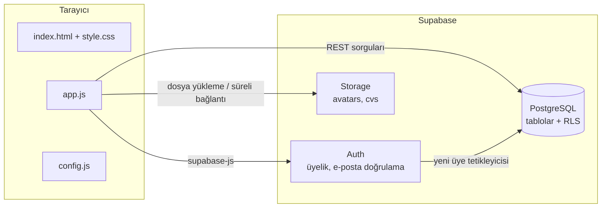
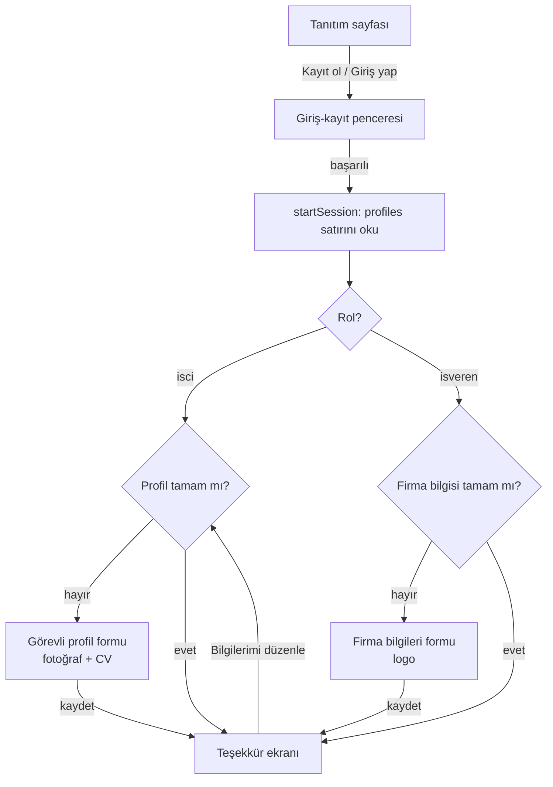

# Mimari

NöbetNet iki parçadan oluşur: tarayıcıda çalışan statik bir ön yüz ve Supabase üzerinde çalışan arka uç.
Ayrı bir uygulama sunucusu yoktur. Tarayıcı doğrudan Supabase'e bağlanır; kimin neyi okuyup yazabileceğine veritabanındaki RLS kuralları karar verir.



## Teknolojiler

| Katman | Teknoloji | Neden |
| --- | --- | --- |
| Sayfa | HTML5, `<dialog>`, satır içi SVG ikonlar | Derleme gerektirmez, her hosting'de çalışır |
| Tasarım | Saf CSS, CSS değişkenleri, `prefers-color-scheme` | Açık/koyu tema tek yerden yönetilir |
| Uygulama | Sade JavaScript (ES2017, `async/await`), tek IIFE | Bağımlılık yok, öğrenmesi ve devretmesi kolay |
| Kütüphane | `@supabase/supabase-js@2` (CDN) | Üyelik, veritabanı ve depolama için tek istemci |
| Veritabanı | PostgreSQL (Supabase) | İlişkisel veri, RLS ile satır bazında yetki |
| Dosyalar | Supabase Storage (gizli bucket + süreli bağlantı) | Fotoğraf ve CV herkese açık URL ile dolaşmaz |
| Yazı tipleri | Barlow Condensed, Source Sans 3 (Google Fonts) | Türkçe karakter desteği |

## Ekran akışı (şu an açık olan)



"Profil tamam" kuralları: görevli için cinsiyet, 18 yaş üstü doğum tarihi, medeni durum, telefon, eğitim, bilgisayar bilgisi ve en az bir hizmet (`workerRequired`). İşveren için sektör, şehir, telefon ve en az bir hizmet.

## app.js yapısı

Dosya tek bir kendi kendini çağıran fonksiyon (IIFE) içindedir; dışarıya hiçbir değişken sızmaz.
Dosyanın başındaki **DOSYA HARİTASI** yorumu her bölümü ve içindeki fonksiyonları listeler.

Önemli kavramlar:

- **`state`**: oturumdaki kullanıcı, rol, profil verisi, açık sekme ve filtreler. Ekranlar bu nesneden çizilir.
- **`navTok`**: her ekran değişiminde artan sayaç. Geç dönen bir sorgu, kullanıcı başka ekrana geçtiyse sonucu çizmez (yarış durumunu önler).
- **`esc()`**: kullanıcıdan gelen her metin HTML'e yazılmadan önce bundan geçer (XSS koruması).
- **`q()`**: Supabase yanıtındaki hatayı istisnaya çevirir; `try/catch` ile tek yerde yakalanır.
- **`rowToProfile` / `profileToRow`**: veritabanı sütun adları (snake_case) ile uygulamadaki nesne (camelCase, iç içe) arasında çeviri.
- **`FILES`, `uploadFile`, `fileUrl`**: dosya türü ve boyut kontrolü, `<kullanıcı id>/` klasörüne yükleme, 1 saatlik süreli görüntüleme bağlantısı.

## Kapalı ekranları açmak

İlan, başvuru, aday arama ve davet ekranlarının kodu `app.js` içinde hazırdır, ama `renderPanel` onları çağırmaz.
Veritabanı tarafı (tablolar, görünümler, `respond_invite` ve `candidate_contact` fonksiyonları) zaten kuruludur.

Açmak için `renderPanel` fonksiyonuna bir sekme çubuğu eklenir. Aşağıdaki taslak bir başlangıç noktasıdır, **denenmemiştir**:

```js
function renderPanel(){
  navTok++; state.editing=false;
  var w = state.user.role==='isci';
  var tabs = w
    ? [['dash','Hizmetler'],['list','Açık görevler'],['invites','Davetlerim'],['profile','Profilim']]
    : [['dash','Hizmetler'],['cand','Aday ara'],['jobs','İlanlarım'],['profile','Firma bilgileri']];
  $('panelBody').innerHTML =
    '<div class="tabs" role="tablist">'+tabs.map(function(t){
      return '<button role="tab" data-tab="'+t[0]+'" aria-selected="'+(state.tab===t[0])+'">'+t[1]+'</button>';
    }).join('')+'</div><div id="tabBody"></div>';
  document.querySelectorAll('[data-tab]').forEach(function(b){
    b.onclick=function(){ state.tab=b.dataset.tab; renderPanel(); };
  });
  var views = {dash:renderDash, list:renderList, invites:renderInvites, cand:renderCand, jobs:renderJobs,
               profile: w ? renderProfile : renderEmployerProfile};
  (views[state.tab] || renderDash)();
}
```

Açmadan önce yapılması gerekenler:

1. İşveren hesaplarını onaylı hale getirmek (bkz. [guvenlik-kvkk.md](guvenlik-kvkk.md)). Aksi halde işveren olarak kayıt olan herkes aday listesini görür.
2. Profil formlarının kaydettikten sonra teşekkür ekranı yerine `profile` sekmesinde kalmasını sağlamak.
3. Görevli ve işveren hesaplarıyla uçtan uca test (ilan yayınla → başvur → davet et → kabul et → iletişim bilgisi görünsün).

## Bilinçli tasarım kararları

- **Derleme aracı yok.** Bir öğrenci projesi ve küçük ekip için kurulum ve devri kolaylaştırır. Kod büyüdükçe (yaklaşık 1500 satırdan sonra) Vite + ES modüllerine geçmek mantıklı olur.
- **İş kuralları veritabanında.** Firma adı, davet durumu, rol gibi alanları istemci değil tetikleyiciler yazar. Tarayıcıdaki kod değiştirilse bile sahte firma adıyla ilan açılamaz, rol değiştirilemez.
- **İletişim bilgisi gizli.** İşveren adayın telefonunu ve e-postasını ancak aday daveti kabul ettikten sonra, `candidate_contact` fonksiyonu üzerinden görebilir.
