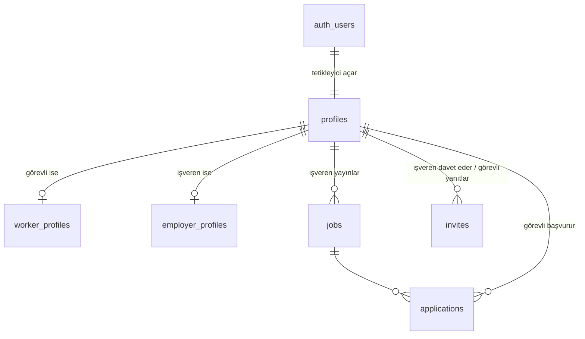

# Veritabanı

Tüm şema `supabase/migrations/` içindeki dört dosyadan oluşur (çalıştırma sırası: [../supabase/README.md](../supabase/README.md)).

## Tablolar

| Tablo | İçerik | Kim okur / yazar |
| --- | --- | --- |
| `profiles` | Her üyenin rolü (`isci` / `isveren`), adı, e-postası, fotoğraf yolu | Yalnızca kendisi. Rol değiştirilemez (sadece `full_name` ve `avatar_path` güncellenebilir) |
| `worker_profiles` | Görevlinin kişisel bilgileri, belgeleri, dilleri, hizmet tercihleri, CV yolu | Yalnızca kendisi |
| `employer_profiles` | Firmanın sektörü, şehri, telefonu, ihtiyaç duyduğu hizmetler | Yalnızca kendisi |
| `jobs` | İş ilanları (pozisyon, şehir, vardiya, kadro, ücret) | Giriş yapan herkes okur; yalnızca işveren kendi ilanını açar, değiştirir, siler |
| `applications` | İlan başvuruları | Görevli kendi başvurusunu görür ve açar |
| `invites` | Görüşme davetleri ve durumu (`bekliyor` / `kabul` / `red`) | Davetin iki tarafı görür; yalnızca işveren açar |

## Görünümler

| Görünüm | Ne gösterir | Not |
| --- | --- | --- |
| `candidates` | Adaylar: kısaltılmış ad ("Ahmet Y."), yaş, belgeler, hizmetler. Telefon, e-posta ve doğum tarihi yok | Yalnızca işveren hesaplarına satır döner |
| `job_applicants` | İşverenin kendi ilanlarına başvuranlar | Başka işverenin başvuranları görünmez |

İki görünüm de `security_invoker` modundadır. Kısıtlı veriyi API'ye kapalı `private` şemasındaki `candidates_data()` ve `job_applicants_data()` fonksiyonları üretir (`03_gorunum_guvenlik.sql`).

## Fonksiyonlar ve tetikleyiciler

| Ad | Tür | Görevi |
| --- | --- | --- |
| `handle_new_user` | Tetikleyici (`auth.users` ekleme) | Yeni üye için `profiles` satırı açar, rolü kayıt bilgisinden alır |
| `set_invite_defaults` | Tetikleyici (`invites` ekleme) | İşveren adını sunucu yazar, durumu her zaman `bekliyor` başlatır |
| `set_job_company` | Tetikleyici (`jobs` ekleme) | İlandaki firma adını sunucu yazar (sahte firma adı engellenir) |
| `is_employer()` | Fonksiyon | Oturumdaki kullanıcı işveren mi |
| `respond_invite(id, kabul)` | Fonksiyon | Görevli daveti kabul eder veya reddeder |
| `candidate_contact(görevli)` | Fonksiyon | İşverene adayın telefon ve e-postasını verir; yalnızca davet kabul edildiyse |
| `candidate_service_counts()` | Fonksiyon | Hizmet başına aday sayısı (panodaki sayaçlar) |

## Dosya depolama

| Bucket | İçerik | Sınır | Erişim |
| --- | --- | --- | --- |
| `avatars` | Profil fotoğrafı / firma logosu | 2 MB; JPG, PNG, WEBP | Gizli; yalnızca sahibi, 1 saatlik süreli bağlantıyla |
| `cvs` | Görevli CV'si | 5 MB; PDF, DOC, DOCX | Gizli; yalnızca sahibi |

Dosya yolu her zaman `<kullanıcı id>/<tür>-<zaman damgası>.<uzantı>` biçimindedir. Erişim kuralları yolun ilk klasörünü oturumdaki kullanıcının kimliğiyle karşılaştırır. Yeni dosya yüklenince eskisi silinir.

## Yeni değişiklik eklerken

1. `supabase/migrations/` içinde bir sonraki numarayla yeni dosya aç (`05_...sql`).
2. Mümkünse tekrar çalıştırılabilir yaz: `if not exists`, `drop policy if exists` + `create policy`.
3. Yeni tabloda RLS'i aç, `anon` yetkisini kaldır, gereken yetkiyi yalnızca `authenticated`'a ver.
4. Çalıştırdıktan sonra **Advisors > Security Advisor**'da hata kalmadığını kontrol et.
5. Bu belgedeki tabloları güncelle.
